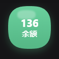
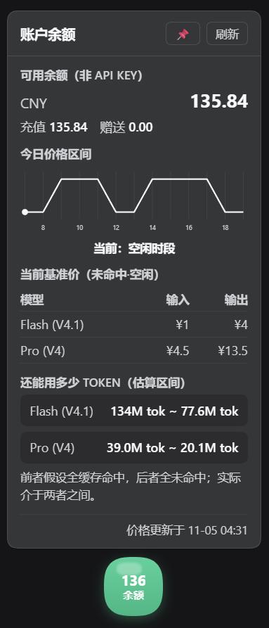

# dsh-balance-ball

[](https://www.npmjs.com/package/dsh-balance-ball)
[](https://www.npmjs.com/package/dsh-balance-ball)
[](https://github.com/StarRob1n/dsh-account-balance/blob/main/LICENSE)
[](https://github.com/awesome-dsh-plugin/awesome-dsh-plugin)

DeepSeek Harness 插件：一个可拖动的悬浮球，常驻显示你的 **DeepSeek 账户余额**，点击展开详情面板，查看实时价格、今日价格走势和 token 消耗估算。





## 功能

- **悬浮球**：圆形、可拖动、可固定，颜色随余额状态变化（绿=充足、黄=少于10元、红=耗尽）
- **账户余额**：充值钱包 + 赠送钱包（OAuth 登录专用，非 API key 余额）
- **实时价格**：从 DeepSeek 官方定价页自动抓取 Flash / Pro 的输入输出单价
- **今日价格走势**：折线图展示一天内高峰/空闲时段的价格变化，标注当前所处时段
- **消耗估算区间**：按缓存命中/未命中给出"还能用多少 token"的乐观~悲观区间

## 安装

### 方式一：npm

```bash
dsh plugin add dsh-balance-ball
```

### 方式二：GitHub

```bash
dsh plugin add github:StarRob1n/dsh-account-balance
```

如果你的 DSH profile 不叫默认名字，加上 `--profile <名字>` 指定（profile 名字就是 `~/.dsh/profiles/` 下的目录名）。

安装后重启 DSH，右下角会出现悬浮球。

## 注意事项

1. **需要 OAuth 登录**：本插件读取的是 `deepseek-account`（平台登录）的账户余额，不是 API key 余额。如果你只有 API key、没有账号登录，余额会显示不可用。
2. **价格来源**：价格从 DeepSeek 官方定价页（`api-docs.deepseek.com`）抓取，每 6 小时自动刷新，也可点面板内的"刷新"按钮手动更新。若抓取失败，会回退到内置的兜底参考价，并明确标注。
3. **估算仅供参考**：token 消耗估算假设输入:输出 ≈ 3:1，给出"全缓存命中 ~ 全未命中"区间，实际消耗介于两者之间。

## 兼容性

- DSH >= 0.2.0
- Node >= 20

## License

MIT
